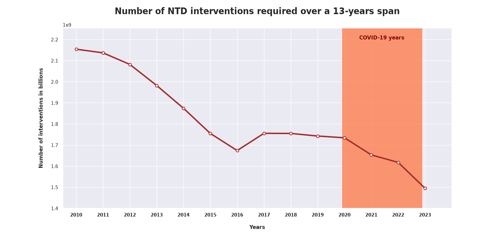
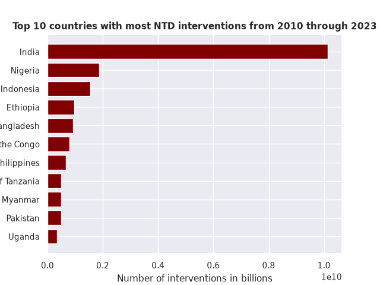
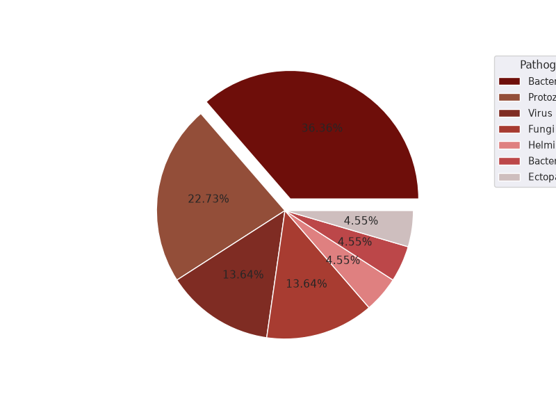
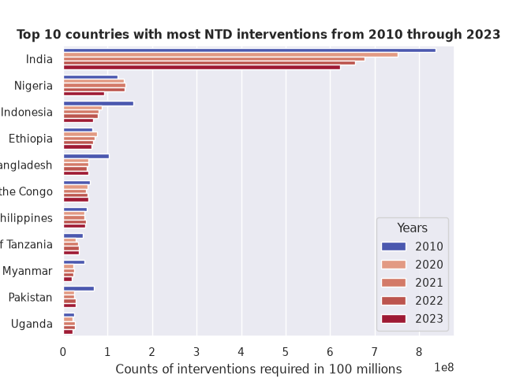

<!-- color: maroon -->

<style>
header, footer {color: maroon;}
</style>


---


<!-- Setting background colour for all + skipping page number -->

<!-- backgroundColor: wheat -->
<!-- _color: maroon -->
<!-- _paginate: skip-->

<!-- Project title -->
# Glimpse on Neglected Tropical Diseases (NTDs) 


-Ameerah FURJUN

---


<!-- diapo: Table of contents -->

<!-- _color: maroon -->
<!-- header:  '**Contents**' -->

<!--*******************************************-->

- **Introduction**
- **Seeing NTD through global stats**
- **Pathogens**

- **Next angles to explore**
- Ref

<!--*******************************************-->


---


<!-- header: '**Introducing NTDs**' -->

**Examples :**

Buruli ulcer
Chagas disease
Chikungunya
Dengue
Echinococcosis
Human African trypanosomiasis
Leishmaniasis
Mycetoma
Onchocerciasis (River blindness)


---
<!-- header: '**Seeing NTDs through global stats**' -->


--- 
<!-- header: '**Seeing NTDs through global stats**' -->


**Global interventions and pathogen distribution accross NTDs**






--- 

<!-- header: '**Seeing NTDs through global stats**' -->


--- 


<!-- header: '**Next**' -->

**Widening Biology angle**
- Map out molecular targets 
- Pattern in mechanisms of defense ?


**Extending to chemistry perspective**
- Regroup/Organize NTD drug data
- Visualize chemical space shared (or not) of NTD drugs and known AMR drugs 


---
<!-- header: '**References**' -->

- **Datasets used:**
    - global NTD data
    - AMR package microorganisms dataset
    - in house "NTD + microorganisms" based on WHO listed NTDs and literature

- **Tools:**
-Matplotlib, Seaborn, Pandas

<!-- 
Example adding code snippet :

```py
#this is a python code
print( x ** 2)
```
-->
